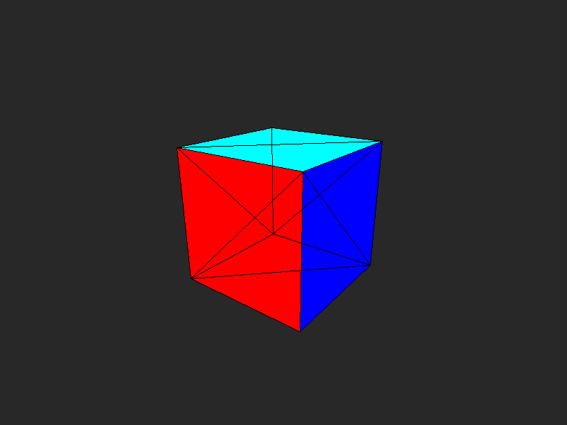

# Software Rasterizer from Scratch

A software rasterizer written in C and C++, built without any graphics libraries or APIs (no OpenGL, no Vulkan, no SDL). All output is written to PPM image files.

## Why

Graphics APIs like OpenGL handle the rendering pipeline for you, so it is easy to use them without knowing what happens inside. The goal of this project is to build every stage by hand, to understand what the GPU is actually doing: from transforming vertices to deciding the color of each pixel.

This is also a learning project for moving from C to C++. Stages 1–3 are written in C. From Stage 4 on, the code is in C++.

## Result



A cube rendered through the full pipeline: model → view → projection → perspective divide → viewport, then filled with edge functions.

## Progress

| Stage | Topic | Language | Status |
|---|---|---|---|
| 1 | Framebuffer and PPM output | C | Done |
| 2 | Line drawing (Bresenham) | C | Done |
| 3 | Filled triangles with edge functions and barycentric interpolation | C | Done |
| 4a | `Vec3` vector class | C++ | Done |
| 4b | `Mat4`, `Vec4`, homogeneous coordinates | C++ | Done |
| 4c | Projection: model → view → projection → viewport | C++ | Done |
| 4d | First 3D cube | C++ | Done |
| 5 | Full scene with Z-buffer | C++ | In progress |
| 6 | Lighting and textures | C++ | Planned |
| 7 | Ray tracing comparison | C++ | Planned |

## Build and Run

Requires `gcc` / `g++` on Linux. No external libraries.

Each `.c` / `.cpp` file with a `main` compiles on its own. The C++ files include the headers in the same folder.

```bash
mkdir -p build

# C stages (example)
gcc -g -Wall -Wextra edgefunction.c -o build/edgefunction
./build/edgefunction

# C++ stages
g++ -std=c++17 -g -Wall -Wextra -Wpedantic -Wconversion cube.cpp -o build/cube
./build/cube
```

Run from the project root. Output images are written to the current directory.

## Files

| File | Description | Output |
|---|---|---|
| `framebuffer.c` | Stage 1: framebuffer and PPM writer | `output.ppm` |
| `drawline.c` | Stage 2: naive line drawing (baseline for comparison) | `draw_line_naive.ppm` |
| `bresenham.c` | Stage 2: Bresenham's line algorithm | `draw_line_bresenham.ppm` |
| `edgefunction.c` | Stage 3: filled triangles with edge functions, and color interpolation with barycentric coordinates | `edgefunction.ppm` |
| `math3d.h` | Stage 4: `Vec3`, `Vec4`, `Mat4` and transform matrices | — |
| `math3d.cpp` | Stage 4: test driver for `math3d.h` | prints to terminal |
| `framebuffer.h` | Stage 4: C++ framebuffer (`std::vector`) and PPM writer | — |
| `raster.h` | Stage 4: `draw_line` (Bresenham) and `draw_triangle` (edge functions) | — |
| `line_test.cpp` | Stage 4: checks the C++ `draw_line` against the C version with `cmp` | `line_test.ppm` |
| `cube.cpp` | Stage 4d: cube mesh, full projection pipeline, wireframe and solid faces | `cube.ppm` |

## Design Decisions

- **Right-handed coordinate system.** Verified by checking that x × y = +z.
- **Edge functions instead of scanline.** Fewer special cases, and closer to how real GPUs rasterize triangles.
- **`w = 1` for points, `w = 0` for directions.** This way, translation only affects points.
- **Transforms are read from right to left:** `projection * view * model`.
- **Vertex buffer + index buffer.** The cube stores 8 unique vertices and 12 triangles as index triples, so each vertex is transformed only once.
- **Counter-clockwise winding, seen from outside.** Checked at startup by `check_winding`: the cross product of each triangle must point away from the center.
- **Pixel centers at `(x + 0.5, y + 0.5)`.** Screen coordinates are converted to pixels with `floor`, not rounding or truncation.
- **Rasterizer functions are free functions, not `Framebuffer` members.** The framebuffer stores pixels; the rasterizer is the algorithm (separation of concerns).

## References

- [Computer Graphics from Scratch](https://gabrielgambetta.com/computer-graphics-from-scratch/) by Gabriel Gambetta
- [ssloy/tinyrenderer](https://github.com/ssloy/tinyrenderer)
